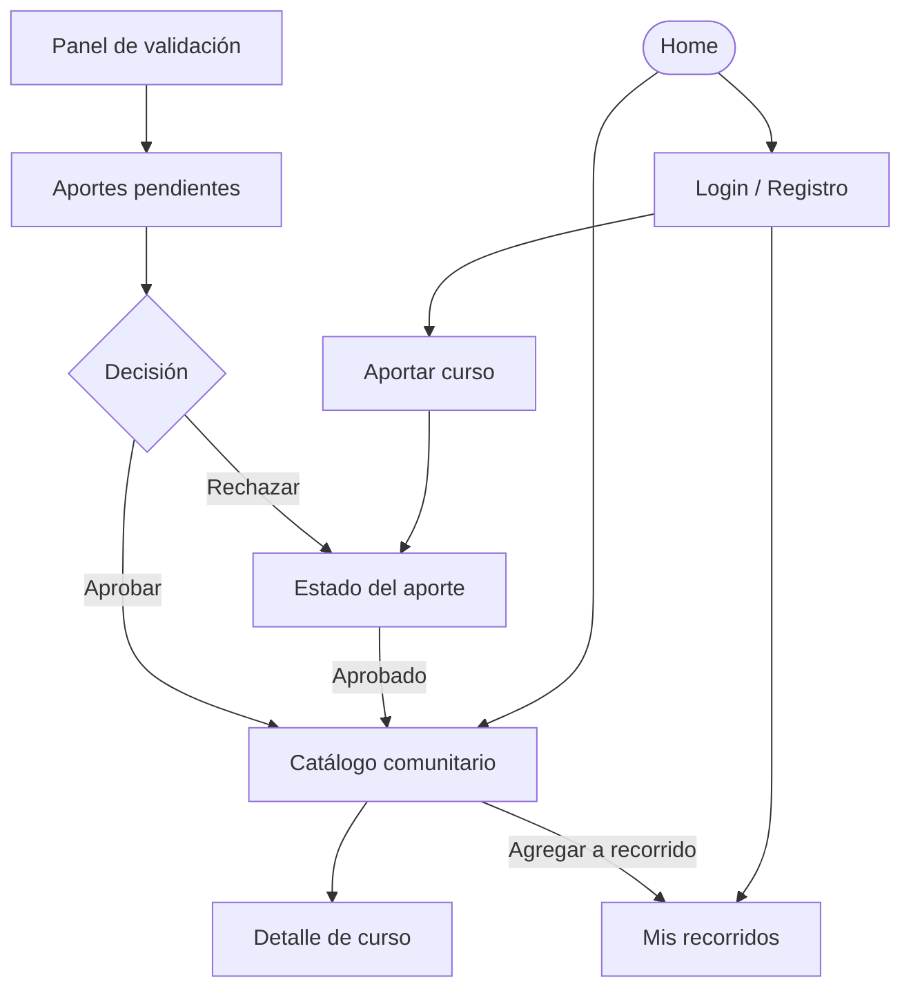

# APPFlow — Mapa del sitio y flujos de usuario — Proyecto20-10

> **Estado:** documentación de la Instancia A. Este documento propone el mapa de navegación, las pantallas y los flujos principales. Las rutas, los permisos y los contratos de API deben validarse contra `PRD.md`, `TRD.md` y `BackendSchema.md` antes de comenzar la implementación.

## 1. Sitemap

El catálogo y los detalles de cursos publicados se proponen como públicos. Aportar cursos y administrar recorridos requiere iniciar sesión. El panel de validación requiere un rol autorizado. Estos permisos quedan sujetos a confirmación con la cátedra.

## 2. Rutas

| Ruta | Pantalla | Requiere login | Notas |

|---|---|---|---|

| `/` | Home | No | Presentación del producto y acceso al catálogo. |

| `/catalogo` | Catálogo comunitario | No | Listado paginado y búsqueda. Filtros sujetos a definición. |

| `/catalogo/:id` | Detalle de curso | No | Información del curso publicado y enlace de origen. |

| `/login` | Inicio de sesión | No | Acceso a la cuenta. |

| `/registro` | Registro | No | Creación de una cuenta. |

| `/roadmap` | Mis recorridos | Sí | Listado de recorridos personales. |

| `/roadmap/nuevo` | Crear recorrido | Sí | Formulario para crear un recorrido. |

| `/roadmap/:id` | Detalle de recorrido | Sí | Cursos incluidos y orden propuesto. Debe verificarse la propiedad del recurso. |

| `/aportar` | Formulario de aporte | Sí | Envío de un curso para revisión. |

| `/aportar/:id/estado` | Estado del aporte | Sí | Consulta del estado de un aporte propio. |

| `/validar` | Panel de validación | Sí, con rol autorizado | Acceso restringido a revisores. |

| `/validar/:id` | Detalle de aporte pendiente | Sí, con rol autorizado | Revisión y decisión sobre un aporte. |

Las rutas son una propuesta de navegación, no rutas implementadas. Si una persona sin sesión intenta ingresar a una ruta protegida, se propone redirigirla a `/login` y conservar la ruta de destino para después del acceso.

## 3. Fichas de pantalla

> Los nombres de endpoints y sus parámetros son contratos propuestos. Deben coincidir con los que se definan en `BackendSchema.md`.

### Pantalla: Home (`/`)

- **Objetivo del usuario:** comprender para qué sirve la plataforma y acceder rápidamente a los cursos.

- **Componentes:** header, navegación principal, presentación breve, botón de acceso al catálogo y accesos a las funciones principales.

- **Estados:** `loading` si depende de datos; `ok`; `error` si falla la carga de contenido dinámico.

- **APIs que consume:** ninguna obligatoria si el contenido es estático. Si se muestran cursos destacados, podría consumir `GET /api/v1/cursos`.

- **Navegación:** hacia Catálogo, Login, Registro y, si hay sesión, Mis recorridos y Aportar curso.

### Pantalla: Catálogo comunitario (`/catalogo`)

- **Objetivo del usuario:** encontrar cursos gratuitos publicados por la comunidad.

- **Componentes:** header, campo de búsqueda, filtros definidos para el catálogo, grilla o lista de tarjetas, paginador, estados vacío y de error.

- **Estados:** `loading` (skeleton), `ok`, `empty` (sin resultados), `error` (opción de reintentar).

- **APIs que consume:** `GET /api/v1/cursos?page=1&page_size=20&q=...` como contrato inicial propuesto. Categorías y otros filtros deberán incorporarse si se confirman en el modelo.

- **Navegación:** desde Home; hacia Detalle de curso; hacia Login si una acción requiere autenticación; hacia Mis recorridos para usuarios autenticados.

### Pantalla: Detalle de curso (`/catalogo/:id`)

- **Objetivo del usuario:** consultar la información de un curso antes de acceder a su fuente o incorporarlo a un recorrido.

- **Componentes:** título, descripción, categoría y metadatos disponibles, enlace al curso, botón para agregarlo a un recorrido y mensajes de error.

- **Estados:** `loading`, `ok`, `not_found` si el curso no existe o no está publicado, `error`.

- **APIs que consume:** `GET /api/v1/cursos/{id}`. El endpoint se propone y debe confirmarse en `BackendSchema.md`.

- **Navegación:** volver al catálogo; abrir el enlace de origen; agregar el curso a un recorrido si hay sesión.

### Pantalla: Login (`/login`)

- **Objetivo del usuario:** iniciar sesión para acceder a las funciones privadas.

- **Componentes:** formulario de credenciales, botón de ingreso, enlace a Registro y mensajes de validación.

- **Estados:** `idle`, `submitting`, `ok`, `validation_error`, `authentication_error`, `network_error`.

- **APIs que consume:** `POST /api/v1/auth/login`, propuesto como contrato inicial.

- **Navegación:** hacia Registro; al destino solicitado después de autenticar; hacia Home si no existe un destino previo.

- **Pendiente:** definir el mecanismo de autenticación, el formato de credenciales y la duración de la sesión.

### Pantalla: Registro (`/registro`)

- **Objetivo del usuario:** crear una cuenta para aportar cursos y gestionar recorridos.

- **Componentes:** formulario de registro, campos obligatorios definidos por el sistema, aceptación de condiciones si corresponden y mensajes de validación.

- **Estados:** `idle`, `submitting`, `ok`, `validation_error`, `conflict`, `network_error`.

- **APIs que consume:** `POST /api/v1/auth/registro`, propuesto como contrato inicial.

- **Navegación:** hacia Login o hacia el área de usuario luego del registro, según la política que se defina.

- **Pendiente:** confirmar los datos obligatorios y la política de verificación de cuentas.

### Pantalla: Mis recorridos (`/roadmap`)

- **Objetivo del usuario:** consultar y administrar sus recorridos personales de aprendizaje.

- **Componentes:** listado de recorridos, botón para crear uno, tarjetas o filas de recorridos y estado vacío.

- **Estados:** `loading`, `ok`, `empty`, `error`, `unauthorized`.

- **APIs que consume:** `GET /api/v1/roadmaps`, endpoint propuesto.

- **Navegación:** hacia Crear recorrido y Detalle de recorrido.

- **Permisos:** requiere sesión. El servidor debe devolver únicamente los recorridos que el usuario esté autorizado a consultar.

### Pantalla: Crear recorrido (`/roadmap/nuevo`)

- **Objetivo del usuario:** crear un recorrido personal para organizar cursos.

- **Componentes:** formulario con nombre y campos adicionales que se definan, acción para guardar y mensajes de validación.

- **Estados:** `idle`, `submitting`, `ok`, `validation_error`, `error`.

- **APIs que consume:** `POST /api/v1/roadmaps`, endpoint propuesto.

- **Navegación:** hacia Mis recorridos al cancelar o hacia el recorrido creado al guardar correctamente.

- **Pendiente:** confirmar qué datos requiere un recorrido y si puede incluir descripción, visibilidad u otros atributos.

### Pantalla: Detalle de recorrido (`/roadmap/:id`)

- **Objetivo del usuario:** visualizar los cursos de un recorrido y organizar su secuencia.

- **Componentes:** título, lista de cursos asociados, acciones para agregar o quitar cursos y controles de orden si se aprueba esa funcionalidad.

- **Estados:** `loading`, `ok`, `not_found`, `error`, `unauthorized`.

- **APIs que consume:** `GET /api/v1/roadmaps/{id}`. Para modificarlo podrían utilizarse `POST /api/v1/roadmaps/{id}/cursos` y `DELETE /api/v1/roadmaps/{id}/cursos/{curso_id}`, sujetos a definición.

- **Navegación:** hacia el catálogo para descubrir cursos y hacia Mis recorridos.

- **Permisos:** verificar en el servidor que el usuario pueda consultar o modificar el recorrido.

### Pantalla: Aportar curso (`/aportar`)

- **Objetivo del usuario:** proponer un curso gratuito para que sea revisado antes de su publicación.

- **Componentes:** formulario, campos obligatorios, validaciones en línea, botón de envío y mensajes de resultado.

- **Estados:** `idle`, `submitting`, `validation_error`, `duplicate_warning`, `ok`, `error`.

- **APIs que consume:** `POST /api/v1/aportes`, endpoint propuesto.

- **Navegación:** hacia Estado del aporte cuando el envío sea aceptado por el sistema.

- **Validaciones propuestas:** campos obligatorios, formato de URL y detección de posibles duplicados.

- **Pendiente:** confirmar el listado exacto de campos con la SPEC original y con la cátedra.

### Pantalla: Estado del aporte (`/aportar/:id/estado`)

- **Objetivo del usuario:** conocer si su aporte está pendiente, aprobado o rechazado.

- **Componentes:** identificación del aporte, estado actual y, si se define, motivo de rechazo.

- **Estados:** `loading`, `en_revision`, `aprobado`, `rechazado`, `not_found`, `error`.

- **APIs que consume:** `GET /api/v1/aportes/{id}`, endpoint propuesto.

- **Navegación:** hacia Catálogo si el aporte fue aprobado y el curso quedó publicado; hacia Aportar curso para realizar otro aporte.

- **Permisos:** el usuario solo puede consultar sus propios aportes, salvo roles autorizados.

### Pantalla: Panel de validación (`/validar`)

- **Objetivo del usuario:** permitir que una persona autorizada encuentre los aportes pendientes de revisión.

- **Componentes:** listado de pendientes, estado, fecha de envío y acceso al detalle.

- **Estados:** `loading`, `ok`, `empty`, `error`, `forbidden`.

- **APIs que consume:** `GET /api/v1/aportes?estado=en_revision`, endpoint propuesto y sujeto a autorización.

- **Navegación:** hacia Detalle de aporte pendiente.

- **Permisos:** requiere sesión y rol autorizado. La interfaz no reemplaza los controles de autorización del servidor.

### Pantalla: Detalle de aporte pendiente (`/validar/:id`)

- **Objetivo del usuario:** revisar la información de un aporte y decidir si cumple los criterios de publicación.

- **Componentes:** datos del curso propuesto, enlace de origen, acciones para aprobar o rechazar y confirmación de la decisión.

- **Estados:** `loading`, `ok`, `submitting`, `conflict`, `error`, `forbidden`.

- **APIs que consume:** `GET /api/v1/aportes/{id}` y una operación de decisión aún por definir, por ejemplo `PATCH /api/v1/aportes/{id}/estado`.

- **Navegación:** hacia Panel de validación luego de procesar la decisión.

- **Pendiente:** definir criterios de revisión, permisos, motivo de rechazo y tratamiento de decisiones simultáneas.

## 4. Flujos de usuario

### Flujo 1 — Aportar un curso al catálogo

1\. El usuario inicia sesión y selecciona **Aportar curso**.

2\. El sistema abre `/aportar`.

3\. El usuario completa los campos que finalmente se definan para el aporte.

4\. La interfaz valida los campos obligatorios y el formato de la URL.

5\. Si los datos no son válidos, se muestran mensajes junto a los campos y se conservan los datos ingresados cuando sea posible.

6\. Si los datos son válidos, se envía `POST /api/v1/aportes`.

7\. Si el servidor acepta el aporte, devuelve una respuesta satisfactoria con su identificador y estado inicial `en_revision` (propuesta).

8\. El sistema informa que el aporte fue recibido y permite consultar `/aportar/:id/estado`.

9\. Si se detecta un posible duplicado, se informa la situación según la regla de negocio que se apruebe.

10\. Si falla la conexión, se muestra un error y se permite reintentar evitando envíos duplicados cuando sea posible.

### Flujo 2 — Descubrir un curso y agregarlo a un recorrido

1\. El usuario entra a `/catalogo`.

2\. El sistema solicita los cursos publicados y muestra los resultados.

3\. El usuario busca o filtra cursos si esas opciones están habilitadas.

4\. Selecciona un curso y accede a `/catalogo/:id`.

5\. Presiona **Agregar a mi recorrido**.

6\. Si no inició sesión, se lo redirige a `/login` y se conserva el destino previsto cuando sea posible.

7\. Si inició sesión, el sistema muestra sus recorridos o le permite crear uno nuevo.

8\. El usuario selecciona el recorrido de destino.

9\. La interfaz envía la operación correspondiente al backend.

10\. Si la operación resulta exitosa, el curso aparece en el recorrido.

11\. Si el curso ya está incluido, se informa la situación sin crear una asociación duplicada.

12\. Si ocurre un error, se muestra un mensaje y se ofrece reintentar.

### Flujo 3 — Validar un aporte

1\. Una persona con rol autorizado inicia sesión y accede a `/validar`.

2\. El sistema consulta los aportes pendientes.

3\. La persona selecciona un aporte y revisa sus datos y el enlace de origen.

4\. Decide aprobarlo o rechazarlo según los criterios que defina la cátedra.

5\. Antes de confirmar, el sistema puede solicitar una segunda confirmación para evitar acciones accidentales.

6\. La interfaz envía la decisión al backend.

7\. Si se aprueba, el aporte pasa al estado correspondiente y el curso puede incorporarse al catálogo público según las reglas definidas.

8\. Si se rechaza, se registra el estado y el motivo si esa funcionalidad queda definida.

9\. El sistema actualiza la lista de pendientes y muestra el resultado.

10\. Si el usuario no tiene permisos, se bloquea la operación y se informa el acceso restringido.

11\. Si otra persona ya procesó el aporte, se informa que el estado cambió y se solicita actualizar la vista.

### Flujo 4 — Registro e inicio de sesión

1\. El visitante elige Registro desde la navegación principal.

2\. Completa los datos requeridos y envía el formulario.

3\. El sistema valida los datos y comunica errores de formato o conflictos, por ejemplo, una cuenta ya registrada.

4\. Si el registro se completa correctamente, el sistema informa el resultado y aplica la política de acceso que se defina.

5\. Para iniciar sesión, el usuario ingresa sus credenciales en `/login`.

6\. Si las credenciales son correctas, se habilitan las funciones autorizadas para su cuenta.

7\. Si son incorrectas, se muestra un mensaje genérico que no revele información sensible.

8\. Si la operación falla por un problema de red, se permite reintentar.

## 5. Estados globales de la app

| Situación | Comportamiento propuesto |

|---|---|

| Sin sesión y ruta protegida | Redirigir a `/login` y conservar el destino original cuando sea posible. |

| Sesión expirada | Informar que debe iniciar sesión nuevamente y redirigir a `/login`. |

| Usuario sin permisos | Mostrar acceso restringido y no ejecutar la operación. |

| Error de red | Mostrar un mensaje comprensible y ofrecer reintentar. |

| Error de validación | Mostrar mensajes junto a los campos correspondientes. |

| Recurso inexistente o no disponible | Mostrar una pantalla de no encontrado sin exponer datos privados. |

| Listado vacío | Explicar que no hay resultados y ofrecer una acción útil si corresponde. |

| Envío en curso | Deshabilitar temporalmente el botón de envío para reducir envíos repetidos. |

| Operación exitosa | Mostrar una confirmación y actualizar la información visible. |

## 6. Relación con el BackendSchema

Los siguientes endpoints constituyen un inventario inicial de contratos propuestos. No deben considerarse implementados hasta que se definan y desarrollen en las instancias correspondientes.

| Operación | Endpoint propuesto | Pantalla relacionada |

|---|---|---|

| Listar cursos publicados | `GET /api/v1/cursos` | Catálogo |

| Consultar un curso | `GET /api/v1/cursos/{id}` | Detalle de curso |

| Registrar una cuenta | `POST /api/v1/auth/registro` | Registro |

| Iniciar sesión | `POST /api/v1/auth/login` | Login |

| Listar recorridos propios | `GET /api/v1/roadmaps` | Mis recorridos |

| Crear recorrido | `POST /api/v1/roadmaps` | Crear recorrido |

| Consultar recorrido | `GET /api/v1/roadmaps/{id}` | Detalle de recorrido |

| Agregar curso a recorrido | `POST /api/v1/roadmaps/{id}/cursos` | Detalle de recorrido |

| Quitar curso de recorrido | `DELETE /api/v1/roadmaps/{id}/cursos/{curso_id}` | Detalle de recorrido |

| Crear aporte | `POST /api/v1/aportes` | Aportar curso |

| Consultar aporte | `GET /api/v1/aportes/{id}` | Estado del aporte |

| Listar aportes pendientes | `GET /api/v1/aportes?estado=en_revision` | Panel de validación |

| Resolver aporte | `PATCH /api/v1/aportes/{id}/estado` | Detalle de aporte pendiente |

Los contratos definitivos deberán especificar parámetros, cuerpos de solicitud, respuestas, errores, autenticación y autorización. Los endpoints de autenticación son especialmente provisionales porque el mecanismo de sesión aún debe confirmarse.

## 7. Decisiones pendientes de validación

- Confirmar si el catálogo incluye filtros por categoría, tema u otros atributos.

- Confirmar los campos obligatorios del formulario de aportes a partir de la SPEC original.

- Definir el mecanismo de autenticación y la gestión de sesiones.

- Confirmar si existe un rol específico de revisor y cómo se asigna.

- Definir los estados y las transiciones permitidas para los aportes.

- Confirmar si los recorridos son privados por defecto y qué acciones de edición se requieren.

- Definir el contrato definitivo de cada API en `BackendSchema.md`.

- Resolver las diferencias entre la tecnología mencionada en la SPEC original y la propuesta técnica de `TRD.md`.

---

**Referencias**

- Nielsen Norman Group — [Information Architecture vs. Sitemaps](https://www.nngroup.com/articles/information-architecture-sitemaps/)

- Nielsen Norman Group — [User Journeys vs. User Flows](https://www.nngroup.com/articles/user-journeys-vs-user-flows/)

