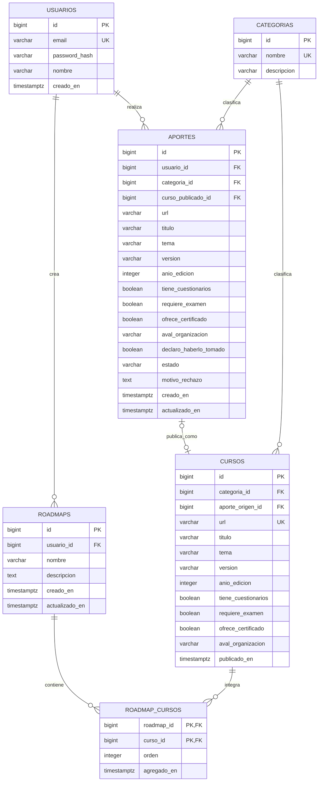
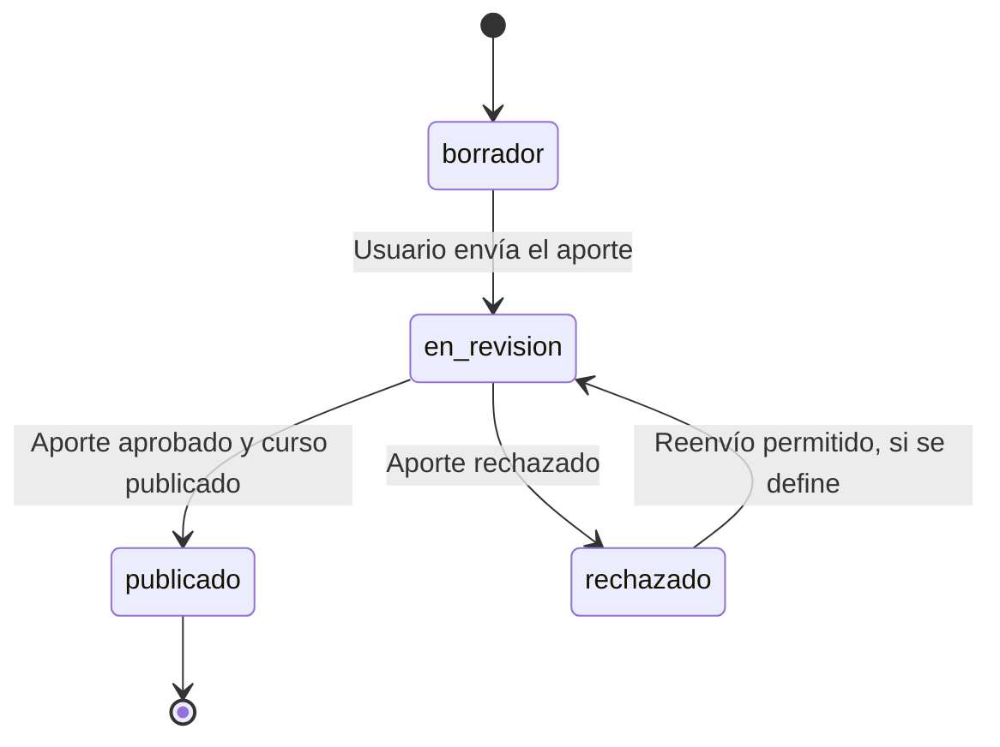

# BackendSchema — Esquema de base de datos y APIs — Proyecto20-10


> **Estado:** propuesta documental de la Instancia A. Define un modelo de datos y contratos de API para revisión. No implica que la base de datos ni los endpoints estén implementados. Las decisiones pendientes deben confirmarse antes de desarrollar.


## 1. Modelo de datos


### 1.1 Diagrama entidad-relación





**Criterio de diseño:** `APORTES` representa las propuestas enviadas por los usuarios y su proceso de revisión. `CURSOS` representa los cursos publicados y disponibles en el catálogo. Cuando un aporte es aprobado, se crea el registro correspondiente en `CURSOS` y se vincula mediante `curso_publicado_id`.


Esta separación evita que una propuesta pendiente o rechazada aparezca como un curso publicado. La relación y el procedimiento de aprobación son una propuesta que debe validarse con la SPEC original.


### 1.2 Tablas


#### `usuarios`


| Columna | Tipo | Constraints | Notas |

|---|---|---|---|

| `id` | `BIGINT GENERATED ALWAYS AS IDENTITY` | PK | Identificador interno. |

| `email` | `VARCHAR(255)` | UNIQUE, NOT NULL | Identificador de acceso; normalizar para evitar duplicados por mayúsculas. |

| `password_hash` | `VARCHAR(255)` | NOT NULL | Hash seguro; nunca almacenar contraseñas en texto plano. |

| `nombre` | `VARCHAR(120)` | NOT NULL | Nombre visible. |

| `rol` | `VARCHAR(20)` | NOT NULL, DEFAULT `'usuario'` | Valores propuestos: `usuario`, `validador`, `admin`. |

| `creado_en` | `TIMESTAMPTZ` | NOT NULL, DEFAULT `now()` | Fecha de creación en UTC. |


**Índices:**

- Restricción única sobre `email`, utilizada en el acceso y para impedir cuentas duplicadas.

- El índice de la clave primaria se genera automáticamente.


**Pendiente:** confirmar si se requieren roles diferenciados de administrador y validador, y cómo se asignan.


#### `categorias`


| Columna | Tipo | Constraints | Notas |

|---|---|---|---|

| `id` | `BIGINT GENERATED ALWAYS AS IDENTITY` | PK | Identificador de categoría. |

| `nombre` | `VARCHAR(100)` | UNIQUE, NOT NULL | Nombre de la categoría. |

| `descripcion` | `VARCHAR(500)` | NULL | Descripción opcional. |


**Índices:**

- Restricción única sobre `nombre`.

- La lista de categorías debe mantenerse controlada para evitar valores inconsistentes.


**Pendiente:** definir el listado oficial de categorías y quién puede modificarlo.


#### `cursos`


| Columna | Tipo | Constraints | Notas |

|---|---|---|---|

| `id` | `BIGINT GENERATED ALWAYS AS IDENTITY` | PK | Identificador del curso publicado. |

| `categoria_id` | `BIGINT` | FK → `categorias.id`, NOT NULL | Categoría del curso. |

| `aporte_origen_id` | `BIGINT` | FK → `aportes.id`, UNIQUE, NOT NULL | Aporte que originó la publicación. |

| `url` | `VARCHAR(2048)` | UNIQUE, NOT NULL | Enlace web de origen. |

| `titulo` | `VARCHAR(200)` | NOT NULL | Título del curso. |

| `tema` | `VARCHAR(200)` | NOT NULL | Tema o área del curso. |

| `version` | `VARCHAR(100)` | NULL | Versión, si corresponde. |

| `anio_edicion` | `SMALLINT` | NULL | Año de edición, si se conoce. |

| `tiene_cuestionarios` | `BOOLEAN` | NOT NULL | Indica si incluye cuestionarios. |

| `requiere_examen` | `BOOLEAN` | NOT NULL | Indica si requiere examen. |

| `ofrece_certificado` | `BOOLEAN` | NOT NULL | Indica si ofrece certificado. |

| `aval_organizacion` | `VARCHAR(200)` | NULL | Organización que avala el curso, si corresponde. |

| `publicado_en` | `TIMESTAMPTZ` | NOT NULL, DEFAULT `now()` | Fecha de publicación. |


**Índices:**

- Restricción única sobre `url` para evitar duplicados exactos.

- Restricción única sobre `aporte_origen_id` para impedir que un mismo aporte origine más de un curso.

- Índice sobre `categoria_id` para filtrar el catálogo.

- Índice sobre `publicado_en` si se requiere ordenar por fecha de publicación.


La unicidad exacta de la URL no detecta todas las variantes de un mismo enlace. La normalización y la detección de posibles duplicados deben definirse antes de implementar.


Los campos booleanos deben recibir un valor explícito al publicar el curso. Si la SPEC permite respuestas desconocidas, se deberá revisar si corresponde admitir valores nulos.


#### `aportes`


| Columna | Tipo | Constraints | Notas |

|---|---|---|---|

| `id` | `BIGINT GENERATED ALWAYS AS IDENTITY` | PK | Identificador del aporte. |

| `usuario_id` | `BIGINT` | FK → `usuarios.id`, NOT NULL | Usuario que realiza el aporte. |

| `categoria_id` | `BIGINT` | FK → `categorias.id`, NOT NULL | Categoría propuesta. |

| `curso_publicado_id` | `BIGINT` | FK → `cursos.id`, NULL | Curso generado al aprobar el aporte. |

| `url` | `VARCHAR(2048)` | NOT NULL | URL propuesta. |

| `titulo` | `VARCHAR(200)` | NOT NULL | Título propuesto. |

| `tema` | `VARCHAR(200)` | NOT NULL | Tema del curso. |

| `version` | `VARCHAR(100)` | NULL | Versión, si corresponde. |

| `anio_edicion` | `SMALLINT` | NULL | Año de edición, si se conoce. |

| `tiene_cuestionarios` | `BOOLEAN` | NOT NULL | Presencia de cuestionarios. |

| `requiere_examen` | `BOOLEAN` | NOT NULL | Requisito de examen. |

| `ofrece_certificado` | `BOOLEAN` | NOT NULL | Disponibilidad de certificado. |

| `aval_organizacion` | `VARCHAR(200)` | NULL | Organización que avala el curso. |

| `declaro_haberlo_tomado` | `BOOLEAN` | NOT NULL | Declaración del usuario al enviar el aporte. |

| `estado` | `VARCHAR(20)` | NOT NULL, DEFAULT `'borrador'` | Estado del proceso de revisión. |

| `motivo_rechazo` | `TEXT` | NULL | Motivo si se rechaza el aporte. |

| `creado_en` | `TIMESTAMPTZ` | NOT NULL, DEFAULT `now()` | Fecha de creación. |

| `actualizado_en` | `TIMESTAMPTZ` | NOT NULL, DEFAULT `now()` | Fecha de última modificación. |


**Estados propuestos para `estado`:** `borrador`, `en_revision`, `publicado`, `rechazado`. Se recomienda implementar una restricción `CHECK` o un tipo controlado para impedir valores inválidos.


**Índices:**

- `usuario_id`, para consultar los aportes de un usuario.

- `estado`, para recuperar aportes pendientes de revisión.

- `categoria_id`, para filtrar por categoría.

- Índice combinado sobre `usuario_id` y `creado_en` para consultar aportes propios ordenados por fecha.


La actualización de `actualizado_en` debe realizarse de forma consistente al modificar el registro. El mecanismo concreto se definirá en la implementación.


#### `roadmaps`


| Columna | Tipo | Constraints | Notas |

|---|---|---|---|

| `id` | `BIGINT GENERATED ALWAYS AS IDENTITY` | PK | Identificador del recorrido. |

| `usuario_id` | `BIGINT` | FK → `usuarios.id`, NOT NULL | Propietario del recorrido. |

| `nombre` | `VARCHAR(150)` | NOT NULL | Nombre del recorrido. |

| `descripcion` | `TEXT` | NULL | Descripción opcional. |

| `creado_en` | `TIMESTAMPTZ` | NOT NULL, DEFAULT `now()` | Fecha de creación. |

| `actualizado_en` | `TIMESTAMPTZ` | NOT NULL, DEFAULT `now()` | Fecha de modificación. |


**Índices:**

- `usuario_id`, para listar los recorridos de cada usuario.

- Índice combinado sobre `usuario_id` y `creado_en` para recuperar los recorridos propios por fecha.


Se propone que cada usuario solo pueda consultar y modificar sus propios recorridos. La visibilidad y las posibles funciones para compartir recorridos quedan pendientes de confirmación.


#### `roadmap_cursos`


| Columna | Tipo | Constraints | Notas |

|---|---|---|---|

| `roadmap_id` | `BIGINT` | PK compuesta, FK → `roadmaps.id` | Recorrido al que pertenece el curso. |

| `curso_id` | `BIGINT` | PK compuesta, FK → `cursos.id` | Curso incorporado. |

| `orden` | `INTEGER` | NOT NULL, CHECK (`orden` > 0) | Posición del curso dentro del recorrido. |

| `agregado_en` | `TIMESTAMPTZ` | NOT NULL, DEFAULT `now()` | Fecha de incorporación. |


**Índices y restricciones:**

- Clave primaria compuesta (`roadmap_id`, `curso_id`) para impedir que un mismo curso se agregue dos veces al mismo recorrido.

- Índice sobre `curso_id` para consultar recorridos que contienen un curso.

- La unicidad de `orden` por recorrido debe definirse si se exige que cada posición sea exclusiva.


### 1.3 Integridad referencial


- Las claves foráneas deben impedir referencias a usuarios, categorías, recorridos o cursos inexistentes.

- La eliminación de usuarios, cursos o recorridos requiere una política explícita. No se propone el borrado en cascada de datos históricos sin validación.

- Solo los cursos publicados deben aparecer en el catálogo público y poder incorporarse a un recorrido.

- Las operaciones de aprobación deben ejecutarse de forma transaccional para evitar crear un curso publicado sin actualizar correctamente el aporte asociado.

- La autorización debe verificarse en el backend; ocultar botones en la interfaz no constituye un control de seguridad.


## 2. Estados del ciclo de vida del curso


El flujo propuesto describe el estado del **aporte** durante la revisión. Un curso se incorpora al catálogo público cuando el aporte se aprueba y se crea su registro en `cursos`.





| Estado | Quién lo ve | Qué puede pasar |

|---|---|---|

| `borrador` | Autor | Completar o editar el aporte y enviarlo a revisión, si se habilita el guardado de borradores. |

| `en_revision` | Autor y rol validador | Consultar el estado; el validador puede aprobar o rechazar. |

| `publicado` | Público en el catálogo; autor y validador pueden consultar el aporte | El curso está publicado y puede incorporarse a recorridos. |

| `rechazado` | Autor y rol validador | Consultar el motivo; posibilidad de corregir y reenviar, si se aprueba esa regla. |


**Reglas de transición propuestas:**


1\. Un aporte nuevo puede comenzar en `borrador` o enviarse directamente a `en_revision`; debe elegirse una única política.

2\. Solo un validador autorizado puede aprobar o rechazar un aporte.

3\. Un aporte aprobado debe originar un único curso publicado.

4\. Un aporte rechazado no debe aparecer en el catálogo público.

5\. Las decisiones deben validar el estado actual para evitar aprobar o rechazar dos veces el mismo aporte.

6\. El reenvío de aportes rechazados, la conservación del historial de decisiones y la posibilidad de editar un aporte en revisión deben confirmarse.


## 3. API REST


### Convenciones generales


- **Prefijo:** `/api/v1`.

- **Formato:** JSON para solicitudes y respuestas, salvo respuestas sin contenido.

- **Paginación:** offset mediante `page` y `page_size`. Valores iniciales propuestos: `page=1`, `page_size=20`; se debe definir un máximo permitido.

- **Respuesta paginada:**


```json

{

  "items": [],

  "total": 0,

  "page": 1,

  "page_size": 20

}

```


- **Fechas:** ISO 8601 en UTC.

- **Identificadores:** enteros positivos generados por la base de datos en esta propuesta.

- **Errores:** se propone el formato Problem Details (`application/problem+json`), coherente con la decisión TD-003 del TRD.


Ejemplo de error:


```json

{

  "type": "about:blank",

  "title": "Error de validación",

  "status": 422,

  "detail": "Uno o más campos no son válidos.",

  "code": "VALIDATION_ERROR"

}

```


Códigos HTTP previstos:

- `200`: operación exitosa con respuesta.

- `201`: recurso creado.

- `204`: operación exitosa sin cuerpo de respuesta.

- `400`: solicitud mal formada.

- `401`: falta autenticación o la sesión no es válida.

- `403`: el usuario no tiene permisos.

- `404`: recurso inexistente o no accesible según la política de seguridad.

- `409`: conflicto, como un duplicado o una transición de estado incompatible.

- `422`: datos con formato válido como JSON, pero que no cumplen las reglas de validación.

- `500`: error interno no previsto, sin exponer detalles sensibles.


### 3.1 Autenticación


| Método | Path | Auth | Request | Respuestas |

|---|---|---|---|---|

| `POST` | `/api/v1/auth/registro` | Pública | `{"email":"...","password":"...","nombre":"..."}` | `201` cuenta creada; `409` email duplicado; `422` validación. |

| `POST` | `/api/v1/auth/login` | Pública | `{"email":"...","password":"..."}` | `200` autenticación exitosa; `401` credenciales inválidas; `422` validación. |

| `POST` | `/api/v1/auth/logout` | Sesión | Sin cuerpo obligatorio | `204` cierre exitoso; `401` sesión inválida si corresponde al mecanismo elegido. |


**Decisión pendiente:** definir si se utilizarán cookies de sesión o tokens, cómo se almacenará y renovará la sesión y qué protección contra CSRF corresponde. La respuesta concreta del login depende de esa elección.


### 3.2 Catálogo de cursos


| Método | Path | Auth | Query / Request | Respuestas |

|---|---|---|---|---|

| `GET` | `/api/v1/cursos` | Pública | `page`, `page_size`, `categoria`, `q` | `200` listado paginado; `422` parámetros inválidos. |

| `GET` | `/api/v1/cursos/{id}` | Pública | Identificador del curso | `200` detalle; `404` inexistente o no publicado. |

| `GET` | `/api/v1/categorias` | Pública | Sin parámetros obligatorios | `200` lista de categorías. |


Los endpoints públicos solo deben devolver cursos publicados. La búsqueda `q` y el filtro `categoria` deben aplicarse a los campos definidos en el contrato, con límites para evitar consultas excesivamente costosas.


Ejemplo de respuesta de `GET /api/v1/cursos?page=1&page_size=2`:


```json

{

  "items": [

    {

      "id": 1,

      "titulo": "Introducción a la programación",

      "tema": "Programación",

      "categoria": {

        "id": 3,

        "nombre": "Tecnología"

      },

      "estado": "publicado"

    }

  ],

  "total": 1,

  "page": 1,

  "page_size": 2

}

```


El ejemplo es ilustrativo; los datos definitivos y los campos de respuesta deben ajustarse al modelo aprobado.


### 3.3 Aportes de cursos y validación


| Método | Path | Auth | Request | Respuestas |

|---|---|---|---|---|

| `POST` | `/api/v1/aportes` | Sesión | Datos del curso y `declaro_haberlo_tomado` | `201` aporte recibido; `409` posible duplicado; `422` validación. |

| `GET` | `/api/v1/aportes/{id}` | Sesión, autor o rol autorizado | Identificador del aporte | `200` detalle y estado; `403` sin permiso; `404` inexistente o no accesible. |

| `GET` | `/api/v1/aportes?estado=en_revision` | Sesión, rol validador | `estado`, `page`, `page_size` | `200` listado paginado; `403` sin permiso; `422` parámetros inválidos. |

| `PATCH` | `/api/v1/aportes/{id}/estado` | Sesión, rol validador | `{"estado":"publicado"}` o `{"estado":"rechazado","motivo_rechazo":"..."}` | `200` decisión aplicada; `403` sin permiso; `404` inexistente; `409` transición incompatible; `422` datos inválidos. |


Al crear un aporte, el servidor debe validar la declaración, los campos requeridos, la categoría y la URL. El estado inicial que se asigne debe coincidir con la política definida para los borradores.


Al aprobar un aporte, el backend debe crear el curso publicado y actualizar el aporte en una misma transacción. Si alguna operación falla, la transacción debe revertirse.


El listado de aportes pendientes debe estar protegido por rol y no debe exponer información privada a visitantes. La respuesta de un aporte debe incluir solo los datos autorizados para el solicitante.


### 3.4 Recorridos del usuario


Se utiliza `/roadmaps` en plural para mantener una convención uniforme en los recursos de la API.


| Método | Path | Auth | Request | Respuestas |

|---|---|---|---|---|

| `GET` | `/api/v1/roadmaps` | Sesión | `page`, `page_size` | `200` recorridos propios paginados; `401` sin sesión; `422` parámetros inválidos. |

| `POST` | `/api/v1/roadmaps` | Sesión | `{"nombre":"...","descripcion":"..."}` | `201` recorrido creado; `422` validación. |

| `GET` | `/api/v1/roadmaps/{id}` | Sesión, propietario | Identificador del recorrido | `200` detalle con cursos; `403` sin permiso; `404` inexistente o no accesible. |

| `POST` | `/api/v1/roadmaps/{id}/cursos` | Sesión, propietario | `{"curso_id":1}` | `201` asociación creada; `404` recorrido o curso inexistente/no publicado; `409` curso ya incluido; `403` sin permiso; `422` validación. |

| `DELETE` | `/api/v1/roadmaps/{id}/cursos/{curso_id}` | Sesión, propietario | Sin cuerpo | `204` asociación eliminada; `403` sin permiso; `404` asociación inexistente o no accesible. |


La lista de recorridos solo debe incluir los del usuario autenticado. Para agregar un curso, el servidor debe verificar que el curso exista y esté publicado.


El orden de los cursos se administra mediante el campo `orden` de `roadmap_cursos`. Si la interfaz permite reordenarlos, se deberá agregar un endpoint específico para actualizar el orden y definir sus reglas de validación.


### 3.5 Resumen de permisos


| Operación | Visitante | Usuario autenticado | Validador |

|---|---|---|---|

| Consultar catálogo publicado | Sí | Sí | Sí |

| Consultar detalle público | Sí | Sí | Sí |

| Crear aporte | No | Sí | Sí, si también tiene permisos de usuario |

| Consultar aporte propio | No | Sí | Sí |

| Consultar pendientes de revisión | No | No, salvo rol adicional | Sí |

| Aprobar o rechazar aportes | No | No, salvo rol adicional | Sí |

| Consultar y administrar recorridos propios | No | Sí | Sí, sobre sus propios recorridos |


La autorización debe comprobarse en el servidor para cada operación. El rol de validador no debe otorgar acceso indiscriminado a datos que no sean necesarios para la revisión.


## 4. Decisiones del esquema


| Decisión | Alternativas | Justificación propuesta |

|---|---|---|

| Categorías como tabla relacionada | Tabla con FK o enum de PostgreSQL | Se propone una tabla para poder administrar categorías y asociarlas mediante claves foráneas. |

| Separación entre aportes y cursos publicados | Una única tabla o tablas separadas | Se proponen tablas separadas para conservar el proceso de revisión y evitar publicar datos pendientes o rechazados. |

| Recorrido como relación intermedia | Lista de identificadores o tabla `roadmap_cursos` | La tabla intermedia permite registrar el orden, aplicar claves foráneas e impedir duplicados por recorrido. |

| Estados del aporte | Texto libre, enum o restricción `CHECK` | Se propone un conjunto cerrado de estados para evitar valores inválidos. |

| Identificadores | UUID o identidad numérica | Se propone identidad numérica por simplicidad; confirmar si la cátedra exige UUID. |

| Prevención de duplicados | URL exacta o normalización y detección adicional | La restricción única es simple, pero la equivalencia entre URLs requiere una regla adicional. |

| Publicación del aporte | Actualización simple o transacción | Se propone una transacción para crear el curso y cambiar el estado sin dejar datos inconsistentes. |


## 5. Decisiones pendientes antes de implementar


1\. Confirmar los campos exactos del curso y del aporte a partir de la SPEC original.

2\. Confirmar si la declaración `declaro_haberlo_tomado` es obligatoria y qué significado tiene para el producto.

3\. Definir si se permite guardar borradores y reenviar aportes rechazados.

4\. Confirmar los roles, los permisos de revisión y la política de registro de usuarios.

5\. Definir el mecanismo de autenticación y la estructura exacta de sus respuestas.

6\. Acordar la normalización de URLs y el tratamiento de posibles duplicados.

7\. Confirmar si los recorridos pueden editarse, reordenarse, compartirse o eliminarse.

8\. Revisar las versiones de PostgreSQL y las tecnologías de backend indicadas en `TRD.md`.

9\. Alinear las rutas de este documento con `APPFlow.md` y resolver las discrepancias con la SPEC original.


---


**Referencias**


- Mermaid — [Entity Relationship Diagrams](https://mermaid.js.org/syntax/entityRelationshipDiagram.html)

- PostgreSQL — [The SQL Language: Data Definition](https://www.postgresql.org/docs/current/ddl.html)

- PostgreSQL — [Constraints](https://www.postgresql.org/docs/current/ddl-constraints.html)


