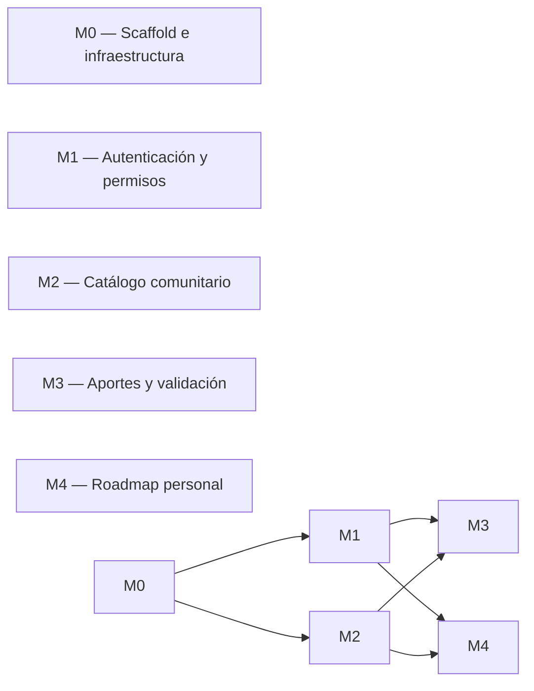

# Implementation Plan — Proyecto20-10

> **Estado:** planificación propuesta para la Instancia B. La Instancia A corresponde a documentación. Las tareas, estimaciones y criterios de aceptación describen el trabajo futuro y no implican que exista una implementación. Las decisiones técnicas pendientes deben confirmarse con la cátedra antes de comenzar.

## 1. MVP — qué es P0

El MVP se considerará funcional cuando, en una máquina limpia, el entorno pueda iniciarse mediante `docker compose up` y se puedan completar de extremo a extremo las historias P0 del PRD, sin errores inesperados en consola.

- **US-001:** consultar el catálogo público paginado sin registrarse.

- **US-002:** aportar un curso con metadatos válidos y dejarlo pendiente de validación.

- **US-003:** consultar aportes pendientes y aprobarlos o rechazarlos mediante un usuario autorizado.

- **US-004:** registrarse e iniciar sesión con credenciales válidas.

### Definición verificable del MVP

El MVP se considerará aceptado si se cumplen todos estos puntos:

1\. El entorno se inicia siguiendo las instrucciones documentadas, sin pasos manuales ocultos.

2\. El catálogo muestra cursos publicados y permite navegar por páginas de hasta 20 resultados.

3\. Un visitante no puede enviar aportes sin autenticarse.

4\. Un usuario registrado puede enviar un aporte válido; los campos obligatorios y el enlace se validan.

5\. Los aportes pendientes y rechazados no aparecen en el catálogo público.

6\. Un usuario autorizado puede aprobar o rechazar un aporte pendiente.

7\. Una propuesta aprobada se publica y puede consultarse en el catálogo.

8\. El registro impide utilizar un email ya registrado y el inicio de sesión rechaza credenciales incorrectas.

9\. Las operaciones restringidas verifican permisos en el backend.

10\. Las pruebas de los flujos P0 finalizan correctamente.

**Fuera del MVP inicial:** rutas personales de aprendizaje (US-005 y US-006), declaración de realización del curso (US-007) y consulta del estado de los aportes propios (US-008). Se planifican como ampliaciones posteriores, salvo modificación de prioridades por la cátedra.

**Condición previa:** confirmar la discrepancia entre FastAPI y Fastify detectada en la documentación de origen. La arquitectura definitiva no se debe implementar hasta resolverla.

## 2. Módulos y dependencias

### Justificación de las dependencias

- **M0 → M1:** autenticación requiere una aplicación ejecutable, configuración y persistencia.

- **M0 → M2:** el catálogo requiere la estructura de aplicación, conexión a la base de datos y datos consultables.

- **M1 → M3:** aportar cursos y validar propuestas requiere identidad y permisos.

- **M2 → M3:** la publicación de aportes debe integrarse con el catálogo público.

- **M1 y M2 → M4:** las rutas personales requieren un usuario identificado y cursos existentes en el catálogo.

M4 es una ampliación P1 y no bloquea la aceptación del MVP P0.

## 3. Detalle por módulo

Las estimaciones son orientativas, expresadas en tiempo de trabajo efectivo. Deben revisarse cuando se confirme el stack, el alcance definitivo y las condiciones de la cátedra.

### M0 — Scaffold e infraestructura

| # | Tarea | Hecho cuando… | Estimación |

|---|---|---|---|

| 0.1 | Crear la estructura de carpetas definida en `TRD.md` | El árbol de directorios coincide con la estructura aprobada y está versionado. | 30 min |

| 0.2 | Configurar Docker Compose y PostgreSQL 18.6, si se confirma esa versión | `docker compose up postgres` inicia el servicio y una comprobación de salud confirma que acepta conexiones. | 45 min |

| 0.3 | Crear el backend mínimo y `GET /health` | Una petición a `http://localhost:8000/health` devuelve HTTP 200 y una respuesta documentada. | 1 h |

| 0.4 | Crear el frontend con React, Vite y el router aprobado | Al ejecutar `pnpm dev`, se muestra el shell inicial y se puede navegar entre las rutas definidas. | 1 h 30 min |

| 0.5 | Configurar variables de entorno y archivos de ejemplo | El proyecto arranca con las variables documentadas y no contiene secretos versionados. | 45 min |

| 0.6 | Documentar el inicio y la detención del entorno | Una persona puede iniciar y detener los servicios siguiendo el README, sin instrucciones adicionales. | 30 min |

### M1 — Autenticación y permisos (P0)

| # | Tarea | Hecho cuando… | Estimación |

|---|---|---|---|

| 1.1 | Implementar el modelo de usuario y su persistencia | Las cuentas se almacenan con identificador único y contraseña protegida mediante hash; nunca en texto plano. | 2 h |

| 1.2 | Implementar el registro | Una solicitud válida crea una cuenta; un email duplicado se rechaza con un error documentado. | 2 h |

| 1.3 | Implementar el inicio de sesión y el cierre de sesión | Las credenciales válidas permiten acceder; las incorrectas son rechazadas y el cierre invalida la sesión según el mecanismo aprobado. | 3 h |

| 1.4 | Implementar la autorización por roles | Las operaciones restringidas rechazan solicitudes anónimas o de usuarios sin permisos. | 2 h |

| 1.5 | Crear las pantallas de registro e inicio de sesión | Los formularios permiten enviar datos, muestran errores comprensibles y responden correctamente a los estados de carga y éxito. | 2 h |

| 1.6 | Probar los casos de autenticación | Las pruebas cubren registro válido, email duplicado, credenciales incorrectas y accesos no autorizados. | 2 h |

### M2 — Catálogo comunitario (P0)

| # | Tarea | Hecho cuando… | Estimación |

|---|---|---|---|

| 2.1 | Crear los modelos de categorías y cursos publicados | El esquema aprobado se crea mediante migraciones y respeta las claves y restricciones documentadas. | 2 h |

| 2.2 | Preparar datos iniciales de categorías y cursos de prueba | Un entorno nuevo dispone de datos de prueba reproducibles y el catálogo puede mostrarlos. | 1 h |

| 2.3 | Implementar `GET /api/v1/cursos` con paginación | La respuesta respeta el tamaño máximo de 20 elementos, informa la paginación y no devuelve cursos no publicados. | 2 h |

| 2.4 | Implementar filtros de catálogo acordados | Cada filtro aprobado devuelve únicamente resultados que cumplen los criterios solicitados; los parámetros inválidos producen errores documentados. | 2 h |

| 2.5 | Implementar `GET /api/v1/cursos/{id}` | Un curso publicado existente devuelve sus datos; un identificador inexistente devuelve HTTP 404. | 1 h |

| 2.6 | Construir la pantalla de catálogo | Se muestran cursos, navegación entre páginas y estados de carga, vacío y error. | 3 h |

| 2.7 | Construir el detalle del curso | La ficha muestra los metadatos disponibles y presenta un estado claro si el curso no existe. | 2 h |

| 2.8 | Probar catálogo, filtros y paginación | Las pruebas verifican resultados, límites de página, filtros y exclusión de cursos no publicados. | 2 h |

### M3 — Aportes y ciclo de validación (P0)

| # | Tarea | Hecho cuando… | Estimación |

|---|---|---|---|

| 3.1 | Crear el modelo de aportes y sus estados | Se pueden persistir propuestas con sus metadatos, autor y estado, respetando las restricciones aprobadas. | 2 h |

| 3.2 | Implementar `POST /api/v1/aportes` | Un usuario autenticado puede enviar una propuesta válida; una propuesta inválida recibe errores de validación documentados. | 2 h |

| 3.3 | Validar los metadatos y enlaces | Los campos obligatorios y el formato del enlace se verifican en el backend; los datos inválidos no se guardan como aportes válidos. | 2 h |

| 3.4 | Implementar la consulta de aportes pendientes | Un usuario con permiso de validación puede consultar los pendientes; los usuarios no autorizados reciben HTTP 403 o el comportamiento documentado. | 2 h |

| 3.5 | Implementar la aprobación y el rechazo | Solo se permiten transiciones válidas desde el estado pendiente; el rechazo registra el motivo cuando corresponda. | 3 h |

| 3.6 | Integrar la publicación con el catálogo | Al aprobar una propuesta se crea o vincula el curso publicado sin duplicar registros ni exponer propuestas pendientes. | 2 h |

| 3.7 | Crear el formulario para aportar cursos | El formulario permite enviar los campos definidos, muestra errores de validación y confirma el envío correcto. | 3 h |

| 3.8 | Crear la interfaz de revisión de aportes | Un usuario autorizado puede consultar pendientes y aprobar o rechazar propuestas con confirmación visible. | 3 h |

| 3.9 | Probar el ciclo completo de validación | Una prueba de extremo a extremo verifica envío, revisión, aprobación, publicación y rechazo sin publicación. | 3 h |

### M4 — Roadmap personal (P1)

Este módulo se implementará después de validar el MVP P0, salvo que la cátedra cambie las prioridades.

| # | Tarea | Hecho cuando… | Estimación |

|---|---|---|---|

| 4.1 | Crear el modelo de rutas personales y su relación con cursos | Las rutas pertenecen a un usuario y sus cursos se relacionan mediante la entidad intermedia definida en `BackendSchema.md`. | 2 h |

| 4.2 | Implementar la creación y consulta de rutas | Un usuario autenticado puede crear rutas y consultar exclusivamente las propias. | 2 h |

| 4.3 | Implementar la edición y eliminación de rutas | El propietario puede modificar o eliminar sus rutas; otros usuarios no pueden hacerlo. | 2 h |

| 4.4 | Implementar la incorporación y eliminación de cursos | Se pueden agregar cursos publicados y quitarlos de una ruta propia; no se admiten cursos inexistentes o no publicados. | 2 h |

| 4.5 | Construir la interfaz de rutas personales | El usuario puede crear, consultar, editar y eliminar sus rutas desde la interfaz. | 3 h |

| 4.6 | Probar los permisos y las operaciones de rutas | Las pruebas cubren operaciones válidas, recursos inexistentes e intentos de acceso a rutas ajenas. | 2 h |

## 4. Ejecución (Instancia B)

Esta tabla es un registro de seguimiento. Los estados deben actualizarse durante la implementación y acompañarse de la rama o el commit correspondiente. No representa trabajo ya realizado.

| # | Tarea | Módulo | Estado inicial | Rama / Commit |

|---|---|---|---|---|

| 0.1 | Estructura de carpetas | M0 | Pendiente | — |

| 0.2 | Docker Compose y PostgreSQL | M0 | Pendiente | — |

| 0.3 | Backend mínimo y health check | M0 | Pendiente | — |

| 0.4 | Frontend y navegación inicial | M0 | Pendiente | — |

| 0.5 | Variables de entorno | M0 | Pendiente | — |

| 0.6 | Instrucciones de ejecución | M0 | Pendiente | — |

| 1.1–1.6 | Autenticación, permisos y pruebas | M1 | Pendiente | — |

| 2.1–2.8 | Catálogo y pruebas | M2 | Pendiente | — |

| 3.1–3.9 | Aportes, validación e integración | M3 | Pendiente | — |

| 4.1–4.6 | Rutas personales y pruebas | M4 | Pendiente | — |

### Flujo de trabajo por tarea

1\. Crear una rama siguiendo la convención acordada en `TRD.md`.

2\. Implementar una tarea o un lote pequeño y coherente.

3\. Ejecutar las pruebas relacionadas y verificar el criterio de aceptación.

4\. Registrar el cambio mediante un commit convencional.

5\. Actualizar el estado de la tarea y su referencia a rama o commit.

6\. Integrar el cambio siguiendo el flujo de revisión acordado para el proyecto.

Ejemplos de nombres de ramas y commits futuros:

- Rama: `feat/catalogo-paginado`; commit: `feat: implementar catálogo paginado`.

- Rama: `feat/validacion-aportes`; commit: `feat: agregar validación de aportes`.

- Rama: `test/auth`; commit: `test: cubrir registro e inicio de sesión`.

Estos ejemplos son propuestas, no ramas ni commits existentes.

## 5. Estrategia de testing

Las pruebas se planifican en esta instancia y se implementarán durante la Instancia B, de acuerdo con las indicaciones de la cátedra.

### Unit tests

- Probar funciones de negocio aisladas, sin base de datos ni HTTP.

- Verificar validación de metadatos y enlaces.

- Verificar las transiciones permitidas de los aportes.

- Verificar las reglas de autorización que puedan probarse de forma aislada.

- Verificar las reglas de incorporación y eliminación de cursos de las rutas.

- Utilizar el patrón AAA: Arrange, Act, Assert.

### Integration tests

- Probar endpoints contra la base de datos definida para el entorno de pruebas.

- Verificar registro, inicio de sesión y permisos.

- Verificar catálogo, filtros y paginación.

- Verificar creación, aprobación y rechazo de aportes.

- Verificar que las propuestas pendientes o rechazadas no aparecen en el catálogo público.

- Verificar la integridad de las relaciones y las restricciones de la base de datos.

### Frontend tests

- Probar estados de carga, error y ausencia de resultados.

- Probar navegación y paginación del catálogo.

- Probar validaciones y mensajes de formularios.

- Probar el comportamiento de las pantallas ante respuestas exitosas y fallidas del backend.

### End-to-end tests

- Visitante consulta el catálogo sin iniciar sesión.

- Usuario se registra, inicia sesión y aporta un curso.

- Usuario autorizado revisa y aprueba un aporte; el curso aparece en el catálogo.

- Usuario autorizado rechaza otro aporte; el curso no aparece publicado.

- Verificar accesos no autorizados a las operaciones protegidas.

### Objetivo de cobertura

Objetivo inicial propuesto: **al menos 80 % de cobertura de líneas en los servicios de negocio**, sin considerar ese porcentaje como sustituto de la calidad de las pruebas. El objetivo y la herramienta de medición deben confirmarse con la cátedra.

## 6. Riesgos del plan

| Riesgo | Impacto | Mitigación |

|---|---|---|

| La documentación original presenta una discrepancia entre FastAPI y Fastify. | Alto: puede obligar a cambiar la arquitectura y rehacer tareas. | Confirmar el backend requerido antes de iniciar M0. |

| El stack o las versiones indicadas no coinciden con las exigencias finales. | Alto: incompatibilidades y retrabajo. | Validar las versiones con la cátedra y registrar las decisiones en `TRD.md`. |

| Las reglas de aprobación y publicación no están confirmadas. | Alto: cursos publicados incorrectamente. | Definir los estados y las transiciones permitidas antes de implementar M3. |

| El formulario de aporte tiene campos o reglas sin confirmar. | Medio: cambios en el modelo y en la interfaz. | Alinear `PRD.md`, `BackendSchema.md` y `APPFlow.md` antes de programar. |

| Los permisos se implementan solo en el frontend. | Alto: usuarios no autorizados podrían ejecutar operaciones restringidas. | Validar los permisos en el backend y cubrirlos con pruebas de integración. |

| Las estimaciones no contemplan problemas de entorno o integración. | Medio: retrasos en la entrega. | Revisar las estimaciones al cerrar cada módulo y priorizar US-001 a US-004. |

| El entorno depende de pasos manuales no documentados. | Alto: el MVP no funciona en una máquina limpia. | Probar periódicamente el inicio desde un entorno limpio siguiendo el README. |

| Las pruebas cubren solo el camino exitoso. | Alto: errores en validaciones, permisos y estados alternativos. | Incluir casos negativos, límites y accesos no autorizados en la estrategia de testing. |

\---

**Referencias**

- `SPEC.md`: alcance y requisitos de la cátedra.

- `SPEC\_ORIGINAL.md`: versión original de la especificación recibida.

- `PRD.md`: historias de usuario, prioridades y criterios de aceptación.

- `TRD.md`: arquitectura, tecnologías, estructura y convenciones.

- `BackendSchema.md`: entidades, estados y contratos de API.

- `APPFlow.md`: rutas, pantallas y flujos de usuario.

- `UX-UI.md`: criterios visuales y de interacción.

- Atlassian — \[Plantilla de plan de proyecto](https://www.atlassian.com/software/confluence/templates/project-plan).

- Shape Up — \[Cómo dividir el trabajo en alcances cerrables](https://basecamp.com/shapeup/).

