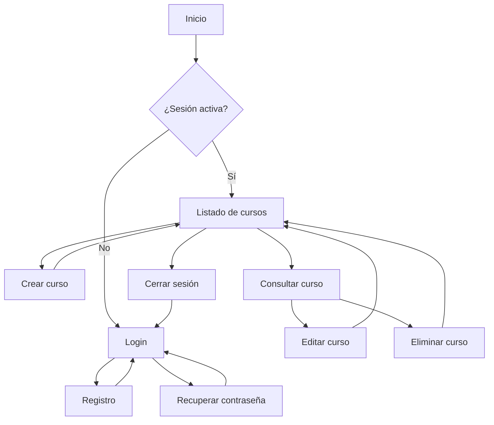

# 🗺️ Mapa de Navegación — Proyecto20-10

## 1. 🧭 Estructura general

La aplicación se organizará en dos áreas principales:

- **Área pública:** acceso, registro y recuperación de contraseña.
- **Área privada:** gestión de cursos y funcionalidades disponibles para usuarios autenticados.

Las rutas definitivas podrán modificarse durante la implementación.

## 2. 📍 Rutas propuestas

| Ruta | Página | Acceso |
|---|---|---|
| `/login` | Inicio de sesión | Público |
| `/register` | Registro | Público |
| `/forgot-password` | Recuperación de contraseña | Público |
| `/courses` | Listado de cursos | Autenticado |
| `/courses/new` | Crear curso | Autenticado |
| `/courses/:id` | Detalle de un curso | Autenticado |
| `/courses/:id/edit` | Editar curso | Autenticado |

Las rutas de detalle y edición son una propuesta de navegación. Podrán resolverse mediante páginas independientes o componentes dentro del listado, según el diseño definitivo.

## 3. 🔀 Flujo general de navegación

## 4. 🍔 Menú de navegación

### Usuarios no autenticados
- Iniciar sesión.
- Crear una cuenta.
- Recuperar contraseña.

### Usuarios autenticados
- Cursos.
- Crear curso.
- Roadmaps de aprendizaje, cuando se incorpore la funcionalidad.
- Cerrar sesión.

Las opciones visibles dependerán de las funcionalidades disponibles y del estado de autenticación.

## 5. 📚 Flujo de gestión de cursos

### Listado
La página principal de cursos permitirá:

- Visualizar los cursos registrados.
- Navegar mediante paginación.
- Acceder a la creación de un curso.
- Consultar, editar o eliminar cursos.

### Creación
1. Acceder al formulario de creación.
2. Completar los campos requeridos.
3. Validar la información.
4. Enviar los datos al backend.
5. Mostrar el resultado de la operación.

### Edición
1. Seleccionar un curso existente.
2. Cargar sus datos.
3. Modificar la información.
4. Validar y guardar los cambios.
5. Informar el resultado.

### Eliminación
1. Seleccionar la acción de eliminar.
2. Solicitar confirmación al usuario.
3. Ejecutar la operación en el backend.
4. Actualizar el listado y mostrar el resultado.

## 6. 🔐 Reglas de navegación

- Las rutas privadas requerirán autenticación válida.
- Un usuario sin sesión que intente ingresar a una ruta privada será redirigido al login.
- El backend deberá validar los permisos necesarios para cada operación.
- Al cerrar sesión, se finalizará la sesión y se redirigirá al usuario al login.
- Los errores de navegación deberán gestionarse de manera clara.

## 7. 📱 Consideraciones Mobile First

- El menú deberá adaptarse al tamaño de pantalla.
- Los formularios deberán ser cómodos de utilizar desde dispositivos móviles.
- Las acciones principales deberán ser fácilmente identificables.
- La paginación deberá funcionar correctamente en pantallas pequeñas.
- Los componentes de la interfaz deberán adaptarse a distintos tamaños de pantalla.

## 8. 📌 Evolución futura

El mapa podrá ampliarse para incorporar páginas de roadmaps, etapas de aprendizaje y detalles de cursos externos cuando se definan e implementen esas funcionalidades.